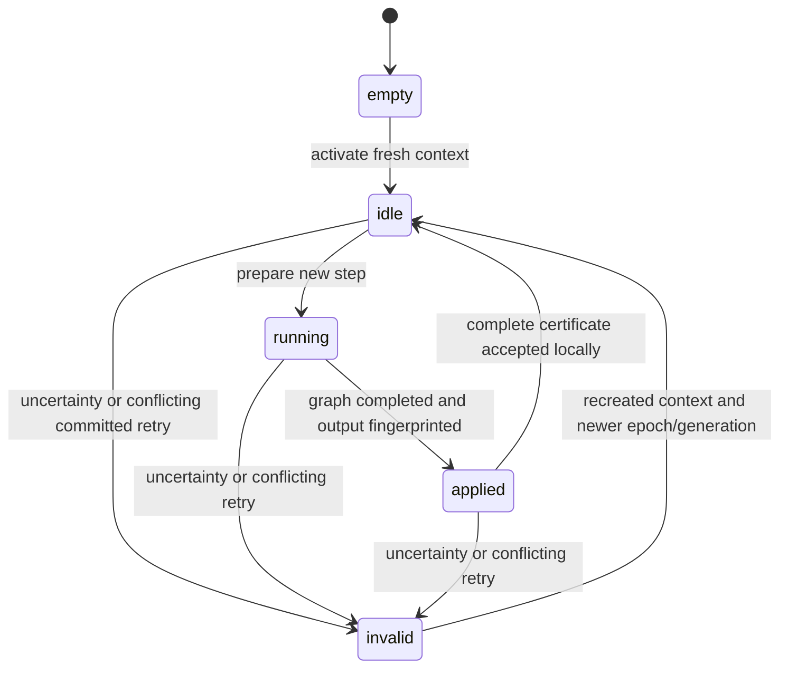

# Owner transaction metadata

`owner_transactions` in tools/glm-rpc is a bounded, single-threaded metadata component. It is not connected to graph execution, authenticated control dispatch, reply caching or a production coordinator yet. It cannot establish global commit, resource admission or READY.

Each instance belongs to one rank and one immutable canonical execution identity. A fresh real context activates a nonzero session and strictly newer epoch and state generation. Activation starts at input position zero, transaction/chunk 1; live contexts cannot silently switch epochs. Invalidation requires real-context stop/discard/recreation before another activation. The component does not perform those operations itself.

`prepare` distinguishes a new execution from exact running, applied or last-committed retries. The caller must never execute a running/applied/committed retry again. Coordinates include identity/session/epoch/generation, transaction, chunk, absolute position, row count and request digest. Owner input fingerprints bind actual payload bytes; rank A's input must match the original request fingerprint. Only one step may be pending. New steps require contiguous transaction/chunk IDs and input positions within the negotiated context/row bounds. No ID may wrap.

The caller marks a step applied only after successful model execution, provider validation, completed copies and output fingerprinting. An owner receipt contains its complete key, rank, end input position and input/output fingerprints. A commit certificate requires exactly A/B/C receipts in rank order, the same complete key/end position, A's original request input, A output equal to B input, and B output equal to C input. Each owner additionally matches its own actual pending receipt before advancing its local committed cursor. A structurally valid certificate does not authenticate its receipts.

Exact committed retries return the stored metadata without advancing position. The immediately previous certificate remains available while the next step is pending. Older receipts expire and refuse; they never trigger re-execution. Reply payloads are not retained here. Production must separately reserve and retain a bounded replay reply whose content matches the certificate, or require reset/replay when that reply is unavailable.

Conflicting valid retries invalidate the local epoch. Malformed/stale inputs rejected before mutation do not create a transaction. A failed commit certificate cannot advance local history. If commit acknowledgements are lost or any outcome is uncertain, a coordinator must stop work and invalidate every affected owner, including owners that already committed locally, then recreate contexts and use a newer epoch/generation before replay. No old-epoch result may be published or reused. Local commit is not global commit: client publication requires all three commit acknowledgements.

No class instance can be copied. Storage is fixed-size metadata for one pending step and one previous three-owner certificate, independent of connection frame sequences. This is not a durable journal. Worker/coordinator restart and reconnect policy, rank-authenticated receipt collection, wire encoding, the global acknowledgement barrier, response cursor, terminal sampling/RNG and replay storage remain unimplemented. Prefix, snapshots and speculative rollback remain unsupported.

The six component suites exercise retry states and expiry, malformed bounds/stamps/IDs, conflicting requests/results, missing/wrong owner and broken-chain certificates, a structurally valid certificate that contradicts actual local results, partial local commits followed by all-owner invalidation, strictly newer epochs and exact context capacity. These are metadata tests, not distributed model execution or production recovery evidence.
