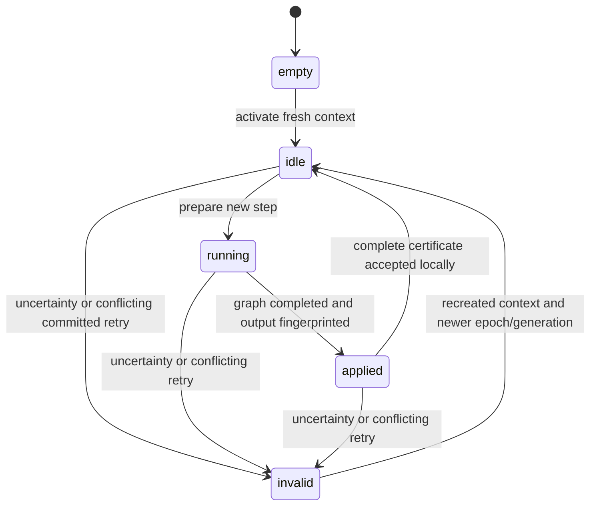

# Owner transaction metadata

`owner_transactions` in tools/glm-rpc is a bounded, single-threaded metadata component. The fourth synthetic pipeline fixture connects it to real local CPU graphs and authenticated control dispatch. Production coordinator/dispatch, bounded reply caching and live retained-weight recovery remain absent. It cannot establish global commit, resource admission or READY.

Each instance belongs to one rank and one immutable canonical execution identity. A fresh real context activates a nonzero session and strictly newer epoch and state generation. Activation starts at input position zero, transaction/chunk 1; live contexts cannot silently switch epochs. Invalidation requires real-context stop/discard/recreation before another activation. The component does not perform those operations itself.

`prepare` distinguishes a new execution from exact running, applied or last-committed retries. The caller must never execute a running/applied/committed retry again. Coordinates include identity/session/epoch/generation, transaction, chunk, absolute position, row count and request digest. Owner input fingerprints bind actual payload bytes; rank A's input must match the original request fingerprint. Only one step may be pending. New steps require contiguous transaction/chunk IDs and input positions within the negotiated context/row bounds. No ID may wrap.

The caller marks a step applied only after successful model execution, provider validation, completed copies and output fingerprinting. An owner receipt contains its complete key, rank, end input position and input/output fingerprints. A commit certificate requires exactly A/B/C receipts in rank order, the same complete key/end position, A's original request input, A output equal to B input, and B output equal to C input. Each owner additionally matches its own actual pending receipt before advancing its local committed cursor. A structurally valid certificate does not authenticate its receipts.

Exact committed retries return the stored metadata without advancing position. The immediately previous certificate remains available while the next step is pending. Older receipts expire and refuse; they never trigger re-execution. Reply payloads are not retained here. Production must separately reserve and retain a bounded replay reply whose content matches the certificate, or require reset/replay when that reply is unavailable.

Conflicting valid retries invalidate the local epoch. Malformed/stale inputs rejected before mutation do not create a transaction. A failed commit certificate cannot advance local history. If commit acknowledgements are lost or any outcome is uncertain, a coordinator must stop work and invalidate every affected owner, including owners that already committed locally, then recreate contexts and use a newer epoch/generation before replay. No old-epoch result may be published or reused. Local commit is not global commit: client publication requires all three commit acknowledgements.

No class instance can be copied. Storage is fixed-size metadata for one pending step and one previous three-owner certificate, independent of connection frame sequences. This is not a durable journal. Worker/coordinator restart and reconnect policy, live rank-authenticated receipt collection, response cursor, terminal sampling/RNG and replay storage remain unimplemented. Prefix, snapshots and speculative rollback remain unsupported.

The six component suites exercise retry states and expiry, malformed bounds/stamps/IDs, conflicting requests/results, missing/wrong owner and broken-chain certificates, a structurally valid certificate that contradicts actual local results, partial local commits followed by all-owner invalidation, strictly newer epochs and exact context capacity. These are metadata tests, component evidence; the separate fourth pipeline profile supplies limited synthetic distributed model execution, not production recovery evidence.

## Fixed control payload encoding

stage-session-codec uses explicit unsigned little-endian fields, not native structure layouts. Applied receipts are exactly 224 bytes; complete commit decisions are exactly 384 bytes. Unknown domains, versions, kinds, nonzero reserved fields, short/trailing bytes, malformed semantics, wrong expected owners and wrong locally pending keys refuse. Commit acknowledgements are a distinct 256-byte payload (kind 3), with one owner-facts record followed by the SHA256 fingerprint of the exact complete encoded decision. The enclosing commit_ack frame kind is 14; existing frame values remain unchanged. An applied receipt cannot decode as a committed acknowledgement.

| Region | Bytes | Fields |
| --- | --- | --- |
| Prefix | 16 | ASCII GLMTXN followed by two zero bytes; LE16 version 1, LE16 kind (1 applied receipt, 2 commit decision, 3 commit acknowledgement), LE32 reserved zero |
| Common key | 128 | identity 32 bytes; session 16 bytes; LE64 epoch, generation, transaction, chunk, position; LE32 rows/reserved zero; request fingerprint 32 bytes |
| Owner facts | 80 each | LE32 rank/reserved zero; LE64 end position; input/output fingerprints 32 bytes each |

A receipt has one owner-facts record; a decision has exactly three in A/B/C order. A committed acknowledgement has one owner-facts record and the 32-byte complete-certificate fingerprint. All fingerprints are raw bytes. Common keys are stored once on the wire and copied into the checked local receipts. Integers above 32 bits are covered by independent Python struct.pack/hashlib golden vectors.

Authenticate the enclosing control frame before decoding. decode_applied_ack and decode_commit_decision additionally correlate its type, authenticated sender/receiver roles, session/epoch/generation, transaction/chunk/position, empty control tensor shape, fragment/count/length facts and nonzero verified sequence with the locally pending step. Control connections form A-B and A-C pairs: applied receipts go to A, and only A sends commit decisions to B/C. The activation data path remains A-B-C. The decoded receipt rank must match its authenticated sender; C cannot issue a commit decision to B. An applied STATE_ACK is never a commit decision or proof of global commitment.

The low-level bare-payload decoders perform structural validation and expected-key/rank checks; they do not authenticate a frame. The future dispatcher must compute fingerprints over canonical unfragmented payload bytes, excluding connection/fragment headers, so retries across fresh connections remain comparable. Model execution, live receipt collection and actual reply publication remain separate integration work.

The target now has nine suites: the six lifecycle cases plus independent golden bytes, exhaustive short lengths/reserved/key/chain refusal and 2,000 deterministic mutated payloads, and authenticated control-envelope/body correlation. Changing only C's output can remain structurally valid, so the authentication test requires MAC rejection before decoding and permanent receiver poisoning. AddressSanitizer/UndefinedBehaviorSanitizer passes the standalone suite with no report. These are component tests, not live distributed transactions.

## Coordinator commit barrier

commit_barrier holds exactly one transaction key, three owner receipt slots and two distinct-owner masks. It is single-writer, noncopyable and metadata-only. The dispatcher supplies A's actual local receipt and B/C receipts decoded after direct peer authentication. Duplicate matching receipts count once. A complete decision is available only after all three matching applied receipts form a valid A-B-C digest chain. Conflicting same-step receipts or a broken complete chain permanently invalidate the barrier. Uncorrelated/stale facts refuse without creating state.

After an owner successfully commits the decision locally, make_commit_ack binds its returned receipt to the complete canonical decision fingerprint. Sending an applied receipt as this acknowledgement is forbidden. The coordinator checks each acknowledgement's authenticated rank, complete key, actual receipt and decision fingerprint. Only all three distinct commit acknowledgements expose committed(). This permits subsequent verification against the retained C payload; it does not publish or retain a response. Repeating A/C acknowledgements can never substitute for B. Any timeout or uncertain outcome requires explicit barrier invalidation plus real all-owner stop/invalidation/context recreation and a newer epoch before replay. Borrowed metadata/output views must be discarded after invalidation.

The caller must enforce cross-step/session progression through the owner ledgers and future coordinator driver; constructing an isolated barrier is not resource admission or a durable journal. Matching local metadata cannot prove a graph executed. Actual payload retention, response cursor, sampling/RNG and network/model reset orchestration remain absent. Metadata/control allocations are not residency-qualified.

The session target now has twelve suites. New cases exercise all 36 applied/committed owner-order combinations, duplicate ACK masks, incomplete decisions, missing B, malformed or conflicting receipts, complete-certificate binding, uncertain partial commits followed by newer-epoch replay, independent Python commit-ACK golden bytes, exact length/reserved-field refusal and authenticated phase/role separation. The full local twelve-CTest/seven-GLM gate and standalone ASan/UBSan pass. Native qualification of the barrier/commit-ACK extension is pending.

The fourth model-process fixture now connects these components to actual graphs and adds an authenticated A-only COMMIT_COMPLETE notice (envelope kind 15, payload kind 4, 176 bytes). Its body contains the complete common key and canonical decision fingerprint, checked against the locally committed decision. Only the coordinator after all commit ACKs may send it. Diagnostic files are withheld until global completion. A lost B commit ACK invalidates every actual owner with zero output; new processes then replay under a fresh session/credential/generation. See TRANSACTION_FIXTURE.md for topology, limitations and evidence. This does not implement a production reply cache or retained-weight distributed recovery.

A bounded immutable reply component now captures applied outputs and retains one previous locally committed reply with full-certificate binding and final-lease byte/page/entry charges. The fourth process fixture uses it for output/retries, including dedicated native-locked B reply pages. This does not establish production reconnect/retry dispatch or complete residency. See REPLY_CACHE.md.

The actual process fixture now also recreates every context/ledger/reply cache against retained owned models after a first-step uncertain commit. A test-controller pipe waits for all-owner invalidation/zero output and supplies a fresh session/newer generation before replay. It is not the production authenticated reset/history protocol. See TRANSACTION_FIXTURE.md.

The fixture now also preserves a committed response row cursor while resetting/replaying the actual input/context cursor. A fixed hash journal verifies already globally completed rows and suppresses duplicate output appends across recovery after 1-row or 56-row prefixes. Production client/RNG history remains absent. See TRANSACTION_FIXTURE.md.

A compact committed terminal outcome codec (kind 5, 272 bytes; envelope 16) now supports explicitly limited stateless greedy C-to-A results with exact raw FP32 candidates. It matches the full pending key/certificate and local vocabulary/count. Thirteen session suites pass, including independent golden bytes and malformed candidate/configuration refusal. See TERMINAL_RESULTS.md.
